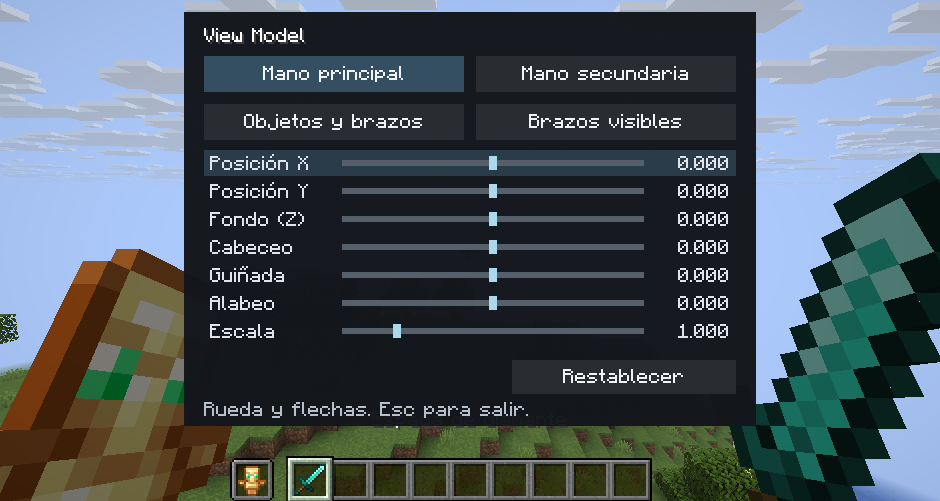

# View Model para Horizon

[English](README.md) · [Русский](README.ru.md)

Ajusta la posición, la rotación y la escala de los modelos que ves en primera persona. La mano principal y la secundaria tienen ajustes independientes. Si cambias de mano dominante, los ajustes pasan al lado correspondiente de la pantalla.



## Instalación y uso

1. Copia [viewmodel.hmod](viewmodel.hmod) en la carpeta `horizon-mods` de tu perfil de Horizon. Activa **View Model for Horizon** en **Opciones → Mods**.
2. Dentro de un mundo, pulsa **V** para abrir el editor. Puedes cambiar la tecla de **Abrir ajustes de View Model** en **Opciones → Controles**. Los mismos ajustes están disponibles en la configuración del mod, en **Opciones → Mods → View Model for Horizon**.
3. Elige una mano y arrastra un control deslizante. Para un ajuste fino, usa la rueda sobre la fila o pulsa la flecha izquierda o derecha. Usa las flechas arriba y abajo o **Tab** para cambiar de fila. **Inicio** restablece el valor seleccionado. El botón **Restablecer** devuelve los siete controles de la mano seleccionada a sus valores predeterminados. Los cambios se ven al instante y se guardan al cerrar el editor.

Un desplazamiento positivo en X mueve el modelo a la derecha y uno en Y lo mueve hacia arriba. Los valores de profundidad (Z) positivos acercan el modelo y los negativos lo alejan. El control, de −16 a +16, se aproxima gradualmente a un límite de profundidad y mantiene el modelo en la misma dirección con respecto a la cámara. La escala cambia el tamaño del modelo alrededor de su posición de reposo. Su valor predeterminado es 1. Los ángulos se indican en grados. Los ajustes se guardan en el perfil de Horizon.

| Qué ajustar | Qué se mueve |
| --- | --- |
| Objetos y brazos | Toda la geometría en primera persona de la mano seleccionada, incluido cualquier mapa y los brazos que lo sostienen |
| Solo objetos | Los objetos sostenidos que se muestran con modelos de objeto normales |
| Solo brazos | El brazo que se ve cuando la mano principal está vacía |

El botón de visibilidad oculta los brazos en primera persona, incluidos los que sostienen mapas. Los objetos y los mapas siguen siendo visibles.

## Diferencias con la versión de Java

Horizon aplica los ajustes antes de calcular la pose habitual de la mano. Por eso, al combinar la rotación, la escala y la pose de un objeto, el resultado puede verse distinto al de Java. El mapa y los brazos que lo sostienen comparten una sola transformación. Las poses independientes para mapas y brazos, los ajustes del movimiento de ataque y las animaciones personalizadas de comer, beber y cambiar de objeto requieren nuevos puntos de extensión en el renderizador de Horizon.

## Compilación

Usa la herramienta de Horizon `cargo horizon-mod` y Rust 1.99.1 con el componente `rust-src`.

```sh
cargo horizon-mod build --wasm
```

La versión del SDK está fijada en `Cargo.toml`. La compilación crea `target/horizon-mod/viewmodel.hmod` y actualiza la suma de comprobación de WASM en el manifiesto.

## Créditos

**I-No-oNe** creó el View Model original para Minecraft Java. Esta adaptación se basa en el [código fuente de la rama 26.3.x de Java](https://github.com/I-No-oNe/View-Model/tree/d3ea13d5432446be42b60da35f3f4a58865f65ee) y usa el icono original. Se distribuye bajo la [licencia MIT](LICENSE).
